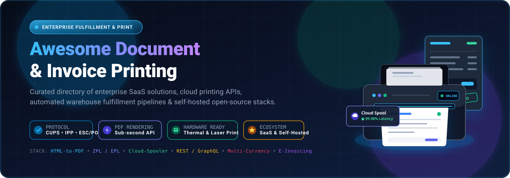

# 🖨️ Awesome Document & Invoice Printing [](https://awesome.re)

<p align="center">
  
</p>

<p align="center">
  <strong>⚡ Curated directory of enterprise SaaS solutions, cloud printing APIs, automated fulfillment document platforms, and self-hosted open-source invoicing systems. 🚀</strong>
</p>

<p align="center">
  <a href="https://github.com/ishandutta2007/Awesome-Awesome-Awesome"></a>
  <a href="https://discord.gg/jc4xtF58Ve"></a>
  <a href="https://github.com/ishandutta2007/Awesome-Document-Invoice-Printing/stargazers"></a>
  <a href="https://github.com/ishandutta2007/Awesome-Document-Invoice-Printing/network/members"></a>
  <a href="https://github.com/ishandutta2007/Awesome-Document-Invoice-Printing/blob/main/LICENSE"></a>
  <a href="https://github.com/ishandutta2007/Awesome-Awesome-Awesome"></a>
  <a href="https://github.com/ishandutta2007"></a>
</p>

---

## 📑 Table of Contents

- [📖 Introduction & Scope](#-introduction--scope)
- [📊 Sector Overview & Market Dynamics](#-sector-overview--market-dynamics)
- [☁️ SaaS & Hosted Platforms](#️-saas--hosted-platforms)
- [💻 Open-Source GitHub Projects](#-open-source-github-projects)
- [🏛️ Architectural Comparison](#️-architectural-comparison)
- [🧭 Platform Selection Matrix](#-platform-selection-matrix)
- [⭐ Star History](#-star-history)
- [💖 Support](#-support)
- [🤝 How to Contribute](#-how-to-contribute)
- [📜 Disclaimer](#-disclaimer)
- [📄 License](#-license)

---

## 📖 Introduction & Scope

💡 **Document & Invoice Printing** software provides the critical fulfillment back-office layer for modern e-commerce stores, B2B wholesale platforms, logistics providers, and independent contractors. These systems automate the creation, tax calculation, multi-currency formatting, PDF rendering, automated email delivery, and physical thermal or desktop cloud printing of invoices, packing slips, pick lists, credit notes, and shipping manifests.

Whether you run a high-volume omnichannel merchant operation requiring low-latency remote hardware printing via cloud APIs or a developer building a sovereign self-hosted accounting pipeline, this guide provides a meticulously researched benchmark of SaaS vendors and open-source GitHub alternatives.

---

## 📊 Sector Overview & Market Dynamics

📈 The global e-invoicing and document printing workflow market was estimated at **$13.8 billion in 2024** and is projected to surpass **$35.9 billion by 2030**, advancing at a compound annual growth rate (CAGR) of **17.3%**.

The sector demonstrates a **moderately fragmented and hybrid market structure**:
- 🏢 **Enterprise & Multi-Carrier Fulfillment Tier**: Consolidated shipping and omnichannel commerce platforms (Shopify, ShipStation/Auctane, Shippo) handle core shipping labels and basic document generation for millions of global merchants, commanding massive GMV throughput.
- 🌐 **Specialized Niche Apps & Cloud Hardware Integrations**: A fragmented ecosystem of specialized apps (Order Printer Pro, Sufio, Invoice Falcon) and dedicated hardware bridge utilities (PrintNode) dominate specialized tax compliance (VAT, GST, Peppol) and zero-click silent thermal printing. Simultaneously, open-source ERP and invoicing frameworks provide fully self-hosted data-sovereign alternatives for cost-conscious engineering teams.

---

## ☁️ SaaS & Hosted Platforms

The table below catalogs premier SaaS document generation, cloud printing, and order printing platforms, sorted in descending order by company scale (market valuation / parent enterprise revenue).

| Platform | Enterprise Valuation / Revenue Scale | Starting Tier Price | Free Tier / Trial Allowance | Primary Specialization & Key Features |
| :--- | :--- | :--- | :--- | :--- |
| **[Shopify Order Printer](https://apps.shopify.com/shopify-order-printer)** | **$100B+ Public Market Cap** ($7.06B ARR parent) | **$0.00/mo** (included with Shopify) | **Free forever** with any active Shopify merchant plan | Native Shopify document printing app; bulk print up to 50 packing slips, invoices, and pick lists with custom HTML/Liquid template editing. |
| **[ShipStation](https://www.shipstation.com/)** | **~$10B Valuation** (Auctane Group subsidiary) | **$9.99/mo** (50 shipments/month) | **30-day free trial** with full feature access and up to 50 test labels | Multi-carrier fulfillment platform; automated packing slip customization, thermal shipping label printing, barcode scan-to-print, and branded tracking. |
| **[Shippo](https://goshippo.com/)** | **$1.0B Valuation** (Unicorn status) | **$19.00/mo** (Professional tier) | **Free forever plan** ($0/mo + 5¢/label on non-carrier accounts, unlimited label/packing slip creation) | Shipping and document API engine; instant packing slip generation, carrier rate comparison, batch PDF manifest printing, and webhooks. |
| **[Order Desk](https://www.orderdesk.com/)** | **~$15M+ ARR** (Bootstrapped enterprise) | **$20.00/mo** (+ 25¢ per order) | **30-day free trial** with unlimited document and integration testing | Rule-based order workflow automation engine; custom invoice and packing slip generation, split fulfillment, and 300+ third-party integrations. |
| **[Fulfillrite](https://www.fulfillrite.com/)** | **~$10M - $25M Revenue** (Mid-market 3PL) | **$0.00/mo platform fee** (Custom pick/pack fees) | **Free consultation and quote** (no software subscription fee; pay per order fulfilled) | Full-service 3PL fulfillment provider; automated custom packing slip insertions, real-time portal printing, and order document fulfillment. |
| **[EasyRoutes](https://www.roundtrip.ai/)** | **~$5M - $10M Valuation** (Roundtrip AI) | **$39.00/mo** (per driver tier) | **14-day free trial** with full route optimization and packing slip printing access | Local delivery route planner and dispatch system; prints organized driver manifests, stop-by-stop packing slips, and delivery labels directly from Shopify. |
| **[Order Printer Pro](https://apps.shopify.com/order-printer-pro)** | **~$5M - $10M Valuation** (FORSBERG+two) | **$10.00/mo** (Starter tier) | **Free forever plan** for up to 50 orders/month; **14-day free trial** on paid tiers | Industry-standard Shopify invoicing app; automated PDF invoice delivery, multi-currency/VAT compliance, Peppol e-invoicing, and bulk print. |
| **[Sufio](https://sufio.com/)** | **~$3M - $8M Valuation** (Independent bootstrapped) | **$7.00/mo** (Starter tier, 15 invoices) | **14-day free trial** with all features and up to 50 test invoices | Certified tax-compliant invoicing software; accountant-validated EU/VAT/GST templates, 40+ languages, automatic customer email delivery, and POS receipts. |
| **[PrintNode](https://www.printnode.com/)** | **~$2M - $5M ARR** (Specialized infrastructure) | **$9.00/mo** (up to 3,000 print jobs) | **Free forever tier** with 1 user, 1 computer, 100 print jobs/month; **7-day free trial** | Cloud printing API and desktop bridge; direct silent printing to any thermal (DYMO, Zebra) or desktop printer (PDF, RAW/ZPL) without print dialogs. |
| **[Invoice Falcon](https://apps.shopify.com/invoice-falcon)** | **~$1M - $3M Valuation** (Specialized app) | **$9.99/mo** (Unlimited plan) | **Free forever plan** for up to 50 invoices/month | Visual invoice template designer for Shopify; automatic PDF attachments, multi-lingual support, POS printing, and credit note issuance. |

---

## 💻 Open-Source GitHub Projects

The table below catalogs top open-source invoicing systems, programmatic PDF rendering engines, and document printing utilities. Repositories are ranked in descending order by GitHub star count.

| Project | Stars | Language / Stack | License | Description & Highlights |
| :--- | :--- | :--- | :--- | :--- |
| **[Invoice Ninja](https://github.com/invoiceninja/invoiceninja)** | [](https://github.com/invoiceninja/invoiceninja/stargazers) | PHP / Laravel / Flutter | Proprietary Open-Source | Comprehensive self-hosted invoicing, billing, client portal, and payment processing suite with multi-company and PDF generation support. |
| **[Akaunting](https://github.com/akaunting/akaunting)** | [](https://github.com/akaunting/akaunting/stargazers) | PHP / Laravel / Blade | GPL-3.0 | Free, full-featured online accounting and invoice management software designed for small businesses and freelancers. |
| **[Crater](https://github.com/crater-invoice-inc/crater)** | [](https://github.com/crater-invoice-inc/crater/stargazers) | PHP / Vue / Flutter | AGPL-3.0 | Open-source invoicing application made for freelancers and small businesses to track expenses, generate estimates, and print branded PDF invoices. |
| **[InvoicePlane](https://github.com/InvoicePlane/InvoicePlane)** | [](https://github.com/InvoicePlane/InvoicePlane/stargazers) | PHP / CodeIgniter | MIT | Lightweight self-hosted web application for managing quotes, invoices, clients, payments, and customizable printable PDF documents. |
| **[Meteroid](https://github.com/meteroid-oss/meteroid)** | [](https://github.com/meteroid-oss/meteroid/stargazers) | TypeScript / Next.js | AGPL-3.0 | Modern pricing, subscription, and invoicing infrastructure supporting complex usage-based billing, automated tax invoicing, and PDF export. |
| **[SolidInvoice](https://github.com/SolidInvoice/SolidInvoice)** | [](https://github.com/SolidInvoice/SolidInvoice/stargazers) | PHP / Symfony | MIT | Elegant open-source invoicing and quotation platform with integrated recurring billing, notification workflows, and PDF document printing. |
| **[Open Source Billing](https://github.com/vteams/open-source-billing)** | [](https://github.com/vteams/open-source-billing/stargazers) | Ruby on Rails | MIT | Clean and simple web-based invoicing tool to generate invoices, track receivables, print paper statements, and collect payments online. |
| **[Invoice Generator (React)](https://github.com/johnuberbacher/invoice-generator)** | [](https://github.com/johnuberbacher/invoice-generator/stargazers) | JavaScript / React | MIT | Single-page invoice creator utilizing `jsPDF` to capture client and line-item details from modal inputs and render downloadable/printable PDFs. |
| **[InvoiceGenerator](https://github.com/by-cx/InvoiceGenerator)** | [](https://github.com/by-cx/InvoiceGenerator/stargazers) | Python | MIT | Standalone Python module and CLI utility for compiling structured invoice data into clean, printable vector PDF documents. |
| **[go-invoice-generator](https://github.com/angelodlfrtr/go-invoice-generator)** | [](https://github.com/angelodlfrtr/go-invoice-generator/stargazers) | Go | MIT | Fluent Go library for generating clean PDF invoices programmatically with tax breakdowns, currency formatting, and company logo embedding. |
| **[invoiced](https://github.com/mpdroog/invoiced)** | [](https://github.com/mpdroog/invoiced/stargazers) | Go / React | MIT | Self-hosted invoicing and hour tracking system storing records as plain TOML files with automatic Git audit commits and UBL XML export. |
| **[TerraPDF](https://github.com/sahebansari/TerraPDF)** | [](https://github.com/sahebansari/TerraPDF/stargazers) | C# / .NET | MIT | Modern .NET library for generating enterprise reports and packing slips with Code128 barcode encoding, QR codes, tables, and AES encryption. |
| **[Zedgerr](https://github.com/vMawk/Zedgerr)** | [](https://github.com/vMawk/Zedgerr/stargazers) | Go / SQLite / Docker | GPL-3.0 | Dockerized accounting and invoicing suite for small businesses, featuring time-to-invoice conversion, EU reverse charge, and multi-country tax presets. |
| **[BulkInvoicer](https://pypi.org/project/bulkinvoicer/)** | *CLI / PyPI* | Python | MIT | Spreadsheet-driven CLI engine that batches hundreds of invoices, summaries, and UPI QR codes into printable customer PDFs directly from Excel. |

---

## 🏛️ Architectural Comparison

```
+-----------------------------------------------------------------------------------------+
|                        DOCUMENT & INVOICE PRINTING ARCHITECTURE                         |
+-----------------------------------------------------------------------------------------+
|                                                                                         |
|  [ Cloud / SaaS Document Services ]                     [ Open-Source & Self-Hosted ]   |
|  * Shopify Order Printer, Order Printer Pro             * Invoice Ninja, Akaunting      |
|  * Sufio, ShipStation, Order Desk                       * Crater, InvoicePlane, invoiced|
|                                                                                         |
|   +------------------------------------+                 +----------------------------+ |
|   | Native Store Webhooks & Triggers   |                 | 100% Data Sovereignty      | |
|   | Certified Global Tax Engine (VAT)  |                 | Zero Per-Invoice Costs     | |
|   | Automatic Peppol e-Invoicing       |                 | Custom Database Schema     | |
|   | Zero Server Infrastructure Setup   |                 | Direct File System Storage | |
|   +------------------------------------+                 +----------------------------+ |
|                     |                                                  |                |
|                     v                                                  v                |
|       [ Cloud Printing API (PrintNode) ]                     [ Local Spooler / CUPS ]   |
|       * Raw ZPL/EPL & Silent Thermal Print                   * Manual browser PDF print |
|       * Web-to-Physical Printer Gateway                      * Driver dependent         |
|                                                                                         |
+-----------------------------------------------------------------------------------------+
```

---

## 🧭 Platform Selection Matrix

1. ⚡ **For turnkey Shopify order printing with zero cost**: Choose **Shopify Order Printer**. Best for basic packing slips and pick lists up to 50 orders per batch.
2. 🌍 **For international e-commerce & strict VAT/tax compliance**: Choose **Sufio** or **Order Printer Pro**. Delivers accountant-certified templates and automated invoice emails.
3. 🖨️ **For silent, automated warehouse & thermal label printing**: Integrate **PrintNode**. Bridges your cloud application directly to DYMO, Zebra, and Epson printers without popup dialogs.
4. 📦 **For multi-carrier fulfillment with shipping documentation**: Choose **ShipStation** or **Shippo**. Combines packing slip printing with bulk label generation.
5. 🛡️ **For complete data ownership & self-hosted invoicing**: Deploy **Invoice Ninja**, **Akaunting**, or **Crater** on your own server.
6. 💻 **For programmatic backend PDF generation**: Use **go-invoice-generator** (Go), **TerraPDF** (.NET), or **by-cx/InvoiceGenerator** (Python).

---

## ⭐ Star History

[](https://star-history.dera.page/#ishandutta2007/Awesome-Document-Invoice-Printing&type=date&legend=top-left)

---

## 💖 Support

A heartfelt **thank you** 🙏 to all developers, warehouse operators, ecommerce merchants, and open-source contributors who build with and support this curated directory!

If you find this repository helpful, please consider supporting the project:
- ⭐ **Star** this repository on GitHub to boost discoverability for the community.
- 🍴 **Fork** and share it with your team, fellow developers, and online store owners.
- 📢 **Contribute**: Submit a PR to add emerging SaaS tools or open-source invoice/printing engines.
- ☕ **Buy me a coffee**: Support ongoing research, benchmarking, and updates via the [GitHub Sponsor Dashboard](https://github.com/sponsors/ishandutta2007).

---

## 🤝 How to Contribute

Contributions are welcome! Please follow these guidelines:

1. 🍴 Fork the repository.
2. 🔍 Verify that any SaaS addition includes concrete starting pricing and specific free trial terms.
3. ⭐ Ensure open-source additions include valid GitHub repository links and star badges (`style=social&color=white`).
4. 📝 Add your entry to the appropriate table, sorted according to category criteria.
5. 🚀 Submit a Pull Request with a clear, concise description of your additions.

---

## 📜 Disclaimer

- This is a **community-curated** list — not exhaustive and not an explicit commercial endorsement.
- Invoicing and tax documentation must comply with local jurisdiction laws (e.g., EU VAT directives, Peppol digital standards, India GST regulations, US state sales taxes).
- Always verify licensing conditions prior to deploying open-source projects in commercial environments.

---

## 📄 License

This repository is licensed under the [MIT License](LICENSE).
